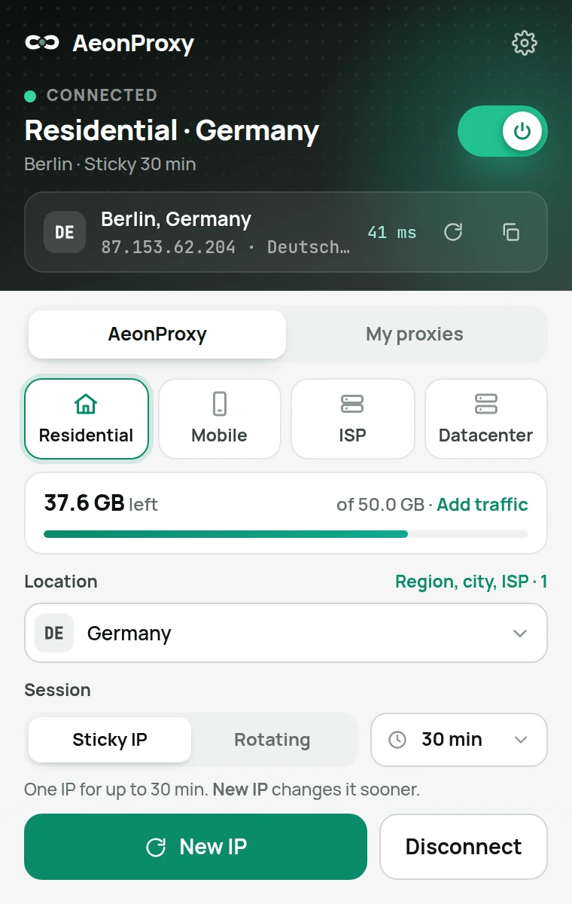
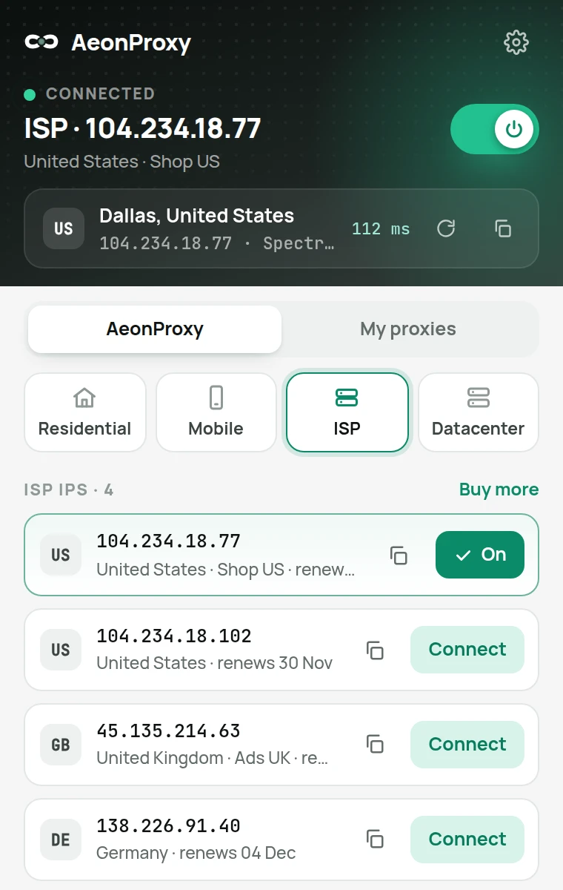
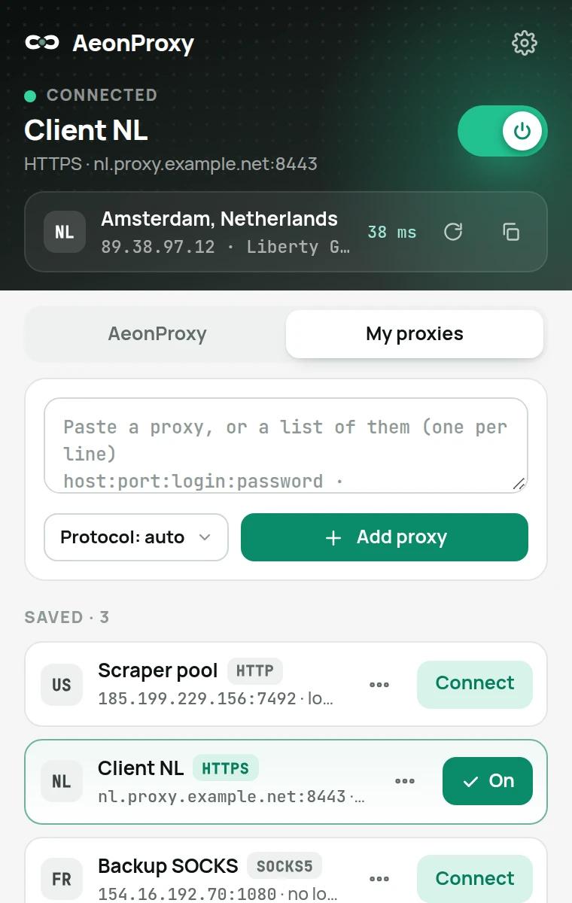

# AeonProxy browser extension

A proxy switcher for Chrome, Edge, Brave, Opera, Vivaldi and other Chromium browsers. Connect the browser to
[AeonProxy](https://aeonproxy.com) residential, mobile, ISP and datacenter proxies in two clicks, or to any HTTP, HTTPS or
SOCKS proxy of your own.

<p>
  
  
  
</p>

## Install

**From the zip** (about a minute): download the latest version from
[aeonproxy.com/browser-extension](https://aeonproxy.com/browser-extension) or this repository's
[Releases](../../releases/latest), unzip it into a folder you will keep, open
`chrome://extensions` (`edge://extensions`, `brave://extensions`, `opera://extensions`), switch on **Developer mode**,
press **Load unpacked** and pick the folder.

**From source:**

```bash
git clone <this repository>
cd aeonproxy-extension
node build.mjs          # Node 22+, no dependencies → dist/chromium/ and dist/aeonproxy-extension-<version>.zip
```

Then load `dist/chromium` the same way (or load `src/` directly while you work on it).

**To update** a copy installed from the zip, unzip the new version over the same folder and press the reload arrow on the
extension's card. Do not remove the extension first: that deletes the proxies saved in it. The popup puts a dot on its
settings button when a new version is out.

## What it does

- **AeonProxy tab.** Sign in with your AeonProxy email and password (plus the Telegram code if you turned it on), or with
  "Sign in with aeonproxy.com", which also covers accounts made with Google. Then:
  - **Residential / Mobile:** pick one of 185+ countries, optionally a region, city and ISP or mobile carrier; keep one IP
    from 1 minute to 6 hours or get a new one for every connection; **New IP** in one click; traffic left and balance.
  - **ISP / Datacenter:** every IP rented on the account, with its label and renewal date; one click to connect.
- **My proxies tab.** Paste one proxy or a list in any common format: `host:port:login:password`,
  `login:password@host:port`, `host:port@login:password`, `login:password:host:port`, `scheme://…`, IPv6 in brackets.
  They are stored in this browser only.
- **Header:** an on/off switch and the IP that sites see now, with its city, network and latency. Errors are spelled out:
  login refused, no traffic left, proxy not answering, another extension holding the proxy setting. The toolbar badge
  shows the exit country.
- **Settings:** WebRTC leak protection (on by default), sites that skip the proxy, light / dark theme.

## Permissions and privacy

| Permission | Why |
|---|---|
| `proxy` | Sets the browser's proxy to the server you pick and clears it when you turn it off. |
| `webRequest`, `webRequestAuthProvider` | Answers the proxy server's login request (HTTP 407), so no password window appears. Page content is not read or changed. |
| `browsingData` | Makes the browser forget the previous proxy login when you switch logins on the same proxy address (see below). Only that proxy address is cleared. |
| `privacy` | WebRTC leak protection: `webRTCIPHandlingPolicy = disable_non_proxied_udp` while a proxy is on. |
| `storage` | Your settings, your own proxies and the sign-in, on this device. |
| `<all_urls>` | The proxy login has to be answered for every site you open through the proxy. |

The extension does not read the pages you open, your history or what you type on sites. It makes requests to:

- `aeonproxy.com`: sign-in, account state, proxy lines and location lists (only when you use the AeonProxy tab), and
  `/downloads/extension.json` to see whether a newer version exists (copies installed from the zip only; store copies
  update themselves);
- `check.aeonproxy.com`: which IP sites see, asked through the proxy (and your own IP while the proxy is off);
- `cloudflare-dns.com`: only when you change the login of one of your own proxies given by a host name (below).

`aeonproxy.com` itself always bypasses the proxy, so signing in and loading lines never go through it.

## How it works

`src/background.js` (the service worker) owns the proxy: it sets `chrome.proxy.settings` to a fixed server with a
bypass list, answers `webRequest.onAuthRequired` with the picked login (and cancels after a second refusal instead of
looping), switches WebRTC protection, checks the exit through `check.aeonproxy.com` and explains failures by asking the
same host over plain HTTP, where a proxy's own refusal (402 / 403 / 407 with an `X-Reason` header) is readable.
`src/popup/` is the UI (no framework, no bundler); `src/lib/parse.js` reads proxy lines.

**Why proxies are connected by IP address.** Chrome keeps one proxy login per proxy address for the whole browser session
and sends it without asking again. A new country on the same `host:port` is a new login on the same address, so Chrome
would silently keep the old one. The only API that makes it forget is `chrome.browsingData.remove({ origins }, { cookies })`,
which also deletes the cookies of the whole registrable domain. So the extension connects to the AeonProxy relay by its
IP address (the account state carries it) and clears that IP origin before each switch; ISP and datacenter proxies are
IPs already. For your own proxies given by a host name, the name is kept while the login on it stays the same; a
different login on the same name is looked up over DNS-over-HTTPS and connected by IP, and only if that fails is the
name's login cleared the cookie way.

## Limits

- Chrome cannot send a login to a SOCKS5 proxy. Use the HTTP port of such proxies; SOCKS5 without a login works.
- A connection that was already open before a switch can keep its old tunnel until the site closes it; new connections
  use the new exit at once.
- Chromium 116 or newer. No Firefox build yet (its proxy API is different).

## Development

```bash
node build.mjs           # dist/chromium + zip
node test/parse.mjs      # unit tests of the proxy-line reader
```

The end-to-end test (real Chromium, a local copy of the site and a test proxy) lives with the site's code.

## License

MIT, see [LICENSE](LICENSE). Fonts: SIL Open Font License 1.1 ([src/fonts/OFL.txt](src/fonts/OFL.txt)).
